# DRIVEAI 100
## A 100-Agent Multi-Agent Research Architecture for Autonomous Driving, Simulation Intelligence, Predictive World Models, and Independent Safety Evaluation

<p align="center">
  <strong>Coordinated Intelligence for the Next Generation of Autonomous Driving Research</strong>
</p>

<p align="center">
  <em>Perception · Sensor Fusion · Prediction · Scenario Generation · Planning · World Models · Safety · Benchmarking</em>
</p>

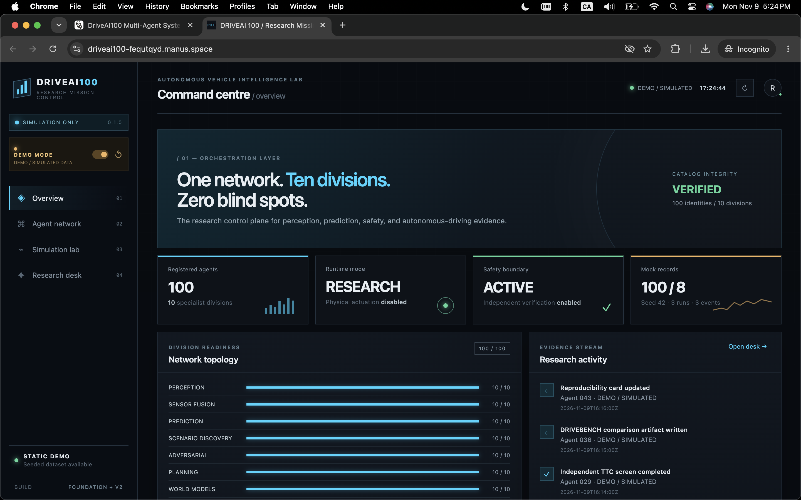

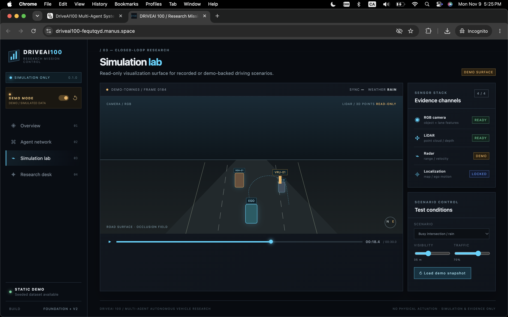

---

## 1. Project Overview

**DRIVEAI 100** is a proposed multi-agent artificial intelligence research platform designed to investigate complex autonomous-driving environments through coordinated specialist agents, simulation-driven experimentation, predictive modelling, adversarial scenario generation, and independent safety evaluation.

Rather than relying on a single general-purpose AI model, DRIVEAI 100 organizes autonomous-driving research into 100 specialized agent roles. Each agent is assigned a bounded responsibility, explicit input and output contracts, defined evaluation criteria, and a controlled communication interface.

The architecture is designed to support experiments involving:

- Multi-modal perception across camera, LiDAR, and radar.
- Probabilistic sensor fusion and uncertainty propagation.
- Vehicle, pedestrian, cyclist, and multi-agent trajectory prediction.
- Procedural and adversarial driving-scenario generation.
- Autonomous-driving planning research in simulated environments.
- Dynamic world-model reconstruction and environmental prediction.
- Independent safety monitoring and evidence generation.
- Reproducible benchmarking across controlled simulation campaigns.
- Research hypothesis generation, experiment tracking, and reporting.

The platform uses a hierarchical multi-agent architecture with a central orchestration layer, ten specialist divisions, and an independent evaluation pipeline.

### 1.1 Core research objective

The primary objective is to create an extensible research infrastructure in which different AI capabilities can be developed, evaluated, compared, and improved independently while remaining interoperable through shared data contracts.

A typical research workflow looks like this:

1. A simulation environment produces sensor observations.
2. Perception agents extract environmental information.
3. Sensor-fusion agents combine observations into a unified representation.
4. Prediction agents estimate possible future trajectories.
5. Scenario agents generate controlled experimental conditions.
6. Planning agents produce candidate decisions for research evaluation.
7. World-model agents maintain a representation of the simulated environment.
8. Independent safety agents evaluate candidate outcomes.
9. Benchmark agents calculate quantitative performance metrics.
10. Research agents organize evidence and identify further experiments.

### 1.2 Research positioning

DRIVEAI 100 is intended as a research and simulation platform, not a certified autonomous-driving system.

The architecture does not establish that a vehicle is safe for public-road deployment. CARLA and ROS 2 integrations should be treated as proposed integration targets until they have been implemented and tested. Likewise, the presence of 100 defined agent roles does not imply that 100 independent production-grade AI models already exist.

The research objective is to create a measurable, reproducible infrastructure for studying autonomous-driving intelligence.

---

## 2. System Architecture

DRIVEAI 100 is organized into five major architectural layers:

1. **Simulation and sensor layer** — generates environmental observations.
2. **Agent intelligence layer** — processes perception, fusion, prediction, scenarios, planning, and world models.
3. **Orchestration layer** — coordinates tasks, dependencies, execution, and communication.
4. **Verification and benchmarking layer** — evaluates outputs independently.
5. **Research layer** — organizes experiments, evidence, and reproducibility records.

### 2.1 High-level architecture

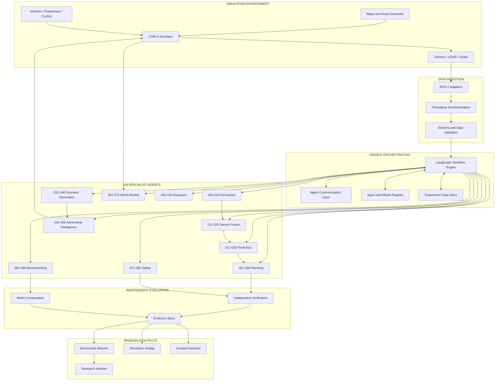

### 2.2 Architectural design principles

| Principle | Engineering implementation |
|---|---|
| Modularity | Each agent exposes a versioned interface. |
| Interoperability | Shared schemas define communication between agents. |
| Observability | Every task produces logs, metrics, and trace identifiers. |
| Reproducibility | Experiments record seeds, versions, parameters, and artifacts. |
| Fault isolation | Agent failures are contained within individual task boundaries. |
| Independent verification | Safety evaluators do not rely exclusively on the agent being evaluated. |
| Extensibility | New agents can be registered without redesigning the entire platform. |
| Traceability | Outputs reference the inputs, models, datasets, and simulation runs that produced them. |

### 2.3 Separation of responsibilities

A key architectural constraint is that scenario generation, candidate planning, and safety verification remain separate responsibilities.

For example, Agent 041 may construct an adversarial pedestrian scenario. Agent 053 may produce a candidate trajectory in a research simulation. Agent 079 independently evaluates evidence about that trajectory.

The scenario generator must not certify the scenario it created, and the planning agent must not be the sole authority evaluating its own output.

---

## 3. The 100-Agent Intelligence Network

The 100 agents are grouped into ten specialist divisions. Each division addresses a distinct part of the autonomous-driving research problem.

The divisions are designed to be independently testable while sharing common data models and experiment identifiers.

### 3.1 Division I — Perception Intelligence (001–010)

**Purpose:** Convert raw simulated sensor observations into structured environmental information.

| ID | Agent | Technical responsibility |
|---|---|---|
| 001 | Vision Perception | Image-based object detection, classification, and localization. |
| 002 | LiDAR Perception | Point-cloud processing, 3D object detection, and geometric analysis. |
| 003 | Radar Intelligence | Doppler measurements, radial velocity, and radar-object interpretation. |
| 004 | Road Segmentation | Drivable areas, lane markings, road boundaries, and road topology. |
| 005 | Traffic Signal Recognition | Traffic-light state, signal localization, and lane association. |
| 006 | Traffic Sign Intelligence | Sign recognition, supplementary panels, and regulatory interpretation. |
| 007 | Pedestrian Detection | Pedestrian localization, pose cues, and crossing-zone observations. |
| 008 | Cyclist and Vulnerable Road User | Cyclists, motorcycles, mobility devices, and other vulnerable road users. |
| 009 | Weather Perception | Visibility, precipitation, fog, glare, and environmental degradation. |
| 010 | Perception Confidence | Confidence calibration, ambiguity detection, and uncertainty reporting. |

**Research focus:** Evaluate how visual conditions, object distance, sensor limitations, and environmental changes influence perception reliability.

Example output:

```json
{
  "agent_id": "DAI-001",
  "task_id": "task-perception-0001",
  "frame_id": "frame-00482",
  "objects": [
    {
      "object_id": "obj-104",
      "class": "pedestrian",
      "bbox": [412, 155, 478, 361],
      "confidence": 0.94
    }
  ],
  "coordinate_frame": "camera_front",
  "model_version": "vision-model-0.1.0",
  "status": "completed"
}
```

### 3.2 Division II — Sensor Fusion Intelligence (011–020)

**Purpose:** Combine multiple sensor observations into a coherent representation while preserving uncertainty and data provenance.

| ID | Agent | Technical responsibility |
|---|---|---|
| 011 | Multi-Sensor Fusion | Combine camera, LiDAR, and radar observations. |
| 012 | Camera-LiDAR Calibration | Estimate and monitor extrinsic and intrinsic calibration. |
| 013 | Radar-LiDAR Fusion | Combine geometric and velocity measurements. |
| 014 | Temporal Sensor Fusion | Align observations across timestamps. |
| 015 | Object Tracking | Maintain object identities and temporal tracks. |
| 016 | Localization Fusion | Combine simulated localization sources. |
| 017 | Ego-Motion Estimation | Estimate the simulated vehicle's motion. |
| 018 | Sensor Health | Detect missing, stale, corrupted, or degraded observations. |
| 019 | Uncertainty Propagation | Track uncertainty through transformations and fusion. |
| 020 | Fusion Arbitration | Resolve conflicting observations and expose unresolved ambiguity. |

**Research focus:** Compare fusion strategies under missing sensor data, calibration drift, timestamp misalignment, and contradictory measurements.

Potential algorithms include:

- Extended Kalman Filters.
- Unscented Kalman Filters.
- Probabilistic data association.
- Bayesian fusion.
- Multi-hypothesis tracking.
- Factor graphs.
- Learned feature-level fusion.

The fusion layer should preserve the source sensor and timestamp associated with each observation.

### 3.3 Division III — Predictive Intelligence (021–030)

**Purpose:** Estimate how traffic participants may move and interact over future time horizons.

| ID | Agent | Technical responsibility |
|---|---|---|
| 021 | Vehicle Trajectory Prediction | Predict future vehicle trajectories. |
| 022 | Pedestrian Behaviour Prediction | Estimate pedestrian movement and crossing hypotheses. |
| 023 | Cyclist Behaviour Prediction | Model cyclist movement and nonlinear manoeuvres. |
| 024 | Traffic Flow Prediction | Estimate traffic density, flow, and congestion. |
| 025 | Intersection Behaviour | Model interactions at intersections. |
| 026 | Lane Change Prediction | Estimate lane-change probability and timing. |
| 027 | Driver Intent Prediction | Infer possible manoeuvre intentions from observed behaviour. |
| 028 | Long-Horizon Prediction | Estimate future states across longer prediction windows. |
| 029 | Multi-Agent Behaviour Prediction | Model interactions between multiple traffic participants. |
| 030 | Prediction Evaluation | Evaluate trajectory accuracy and predictive calibration. |

**Research focus:** Investigate whether interaction-aware prediction produces more useful future-state estimates than independent single-agent trajectory prediction.

A trajectory prediction should include more than one possible future when the evidence is ambiguous.

```json
{
  "agent_id": "DAI-022",
  "object_id": "pedestrian-104",
  "prediction_horizon_seconds": 4.0,
  "hypotheses": [
    {
      "hypothesis_id": "crossing",
      "probability": 0.72,
      "trajectory": [
        {"t": 0.0, "x": 12.1, "y": 4.2},
        {"t": 1.0, "x": 11.5, "y": 4.1},
        {"t": 2.0, "x": 10.8, "y": 3.9}
      ]
    },
    {
      "hypothesis_id": "waiting",
      "probability": 0.28,
      "trajectory": []
    }
  ],
  "uncertainty": {
    "type": "hypothesis_probability",
    "calibrated": false
  }
}
```

The example probabilities are illustrative. A production research implementation should validate calibration against held-out simulation or dataset observations.

### 3.4 Division IV — Scenario Discovery and Generation (031–040)

**Purpose:** Construct controlled simulation scenarios for systematic evaluation.

| ID | Agent | Technical responsibility |
|---|---|---|
| 031 | Scenario Discovery | Identify interesting or underrepresented simulation conditions. |
| 032 | Scenario Generation | Generate parameterized simulation scenarios. |
| 033 | Intersection Scenario | Construct intersection-specific test cases. |
| 034 | Highway Scenario | Construct highway and multi-lane test cases. |
| 035 | Urban Scenario | Generate dense urban traffic conditions. |
| 036 | Weather Scenario | Vary precipitation, fog, lighting, and visibility. |
| 037 | Road Infrastructure Scenario | Vary road geometry and infrastructure conditions. |
| 038 | Rare Event Discovery | Search for unusual or low-frequency events. |
| 039 | Scenario Mutation | Apply controlled mutations to existing scenarios. |
| 040 | Scenario Coverage | Measure coverage across scenario dimensions. |

A scenario is represented as a structured specification rather than a free-form text instruction.

Its parameters may include:

- Map and road segment.
- Number and type of traffic participants.
- Initial participant positions.
- Participant behaviour profiles.
- Weather and lighting.
- Sensor configuration.
- Traffic signal states.
- Simulation duration.
- Random seed.
- Termination conditions.

### 3.5 Division V — Adversarial Traffic Intelligence (041–050)

**Purpose:** Explore difficult, unusual, and boundary-condition environments in simulation.

| ID | Agent | Technical responsibility |
|---|---|---|
| 041 | Adversarial Scenario | Search for challenging traffic configurations. |
| 042 | Occlusion Challenge | Generate controlled visibility limitations. |
| 043 | Unexpected Behaviour | Model unusual but explicitly specified participant behaviour. |
| 044 | Sensor Degradation | Inject controlled sensor faults in simulation. |
| 045 | Multi-Event Challenge | Combine multiple scenario conditions. |
| 046 | Boundary Condition | Test defined operational-domain boundaries. |
| 047 | Behavioural Stress | Increase interaction complexity. |
| 048 | Counterfactual Scenario | Construct paired alternative scenarios. |
| 049 | Failure Reproduction | Recreate previously recorded simulation failures. |
| 050 | Adversarial Test Coordinator | Coordinate adversarial test campaigns. |

**Important constraint:** Adversarial agents are scenario-generation and testing components. They must not have authority to override safety evaluation, disable verification, or connect generated behaviours to real-world vehicle actuation.

### 3.6 Division VI — Autonomous Planning and Decision Intelligence (051–060)

**Purpose:** Study candidate route, behaviour, and motion-planning strategies in controlled simulation.

| ID | Agent | Technical responsibility |
|---|---|---|
| 051 | Route Planning | Compute routes through a map graph. |
| 052 | Behaviour Planning | Evaluate high-level manoeuvre alternatives. |
| 053 | Motion Planning | Generate candidate motion trajectories. |
| 054 | Lane Selection | Evaluate lane-selection alternatives. |
| 055 | Collision Avoidance Research | Analyze predicted trajectory conflicts. |
| 056 | Speed Planning | Study speed profiles and constraints. |
| 057 | Intersection Decision | Evaluate intersection manoeuvre alternatives. |
| 058 | Parking and Low-Speed Manoeuvre | Study low-speed simulated manoeuvres. |
| 059 | Comfort Optimization | Measure acceleration, jerk, and motion smoothness. |
| 060 | Planning Arbitration | Compare candidate plans against defined constraints. |

Planning agents produce research candidates. Their outputs are not treated as certified commands for a real vehicle.

### 3.7 Division VII — World Model and Environmental Intelligence (061–070)

**Purpose:** Maintain structured representations of the current environment and potential future states.

| ID | Agent | Technical responsibility |
|---|---|---|
| 061 | World State Reconstruction | Reconstruct a structured current scene. |
| 062 | 3D Scene Reconstruction | Reconstruct geometric scene representations. |
| 063 | Dynamic World Model | Track changing objects and scene state. |
| 064 | Static Infrastructure Model | Represent roads, curbs, signs, and fixed infrastructure. |
| 065 | Traffic Digital Twin | Maintain a simulated traffic-state representation. |
| 066 | Future Scene Prediction | Estimate future environmental configurations. |
| 067 | Counterfactual World Model | Compare alternative possible scene evolutions. |
| 068 | Map Intelligence | Interpret map topology and road relationships. |
| 069 | Environmental Context | Represent contextual conditions affecting interpretation. |
| 070 | World Model Validation | Compare reconstructed states against simulation ground truth. |

### 3.8 Division VIII — Safety Verification and Risk Intelligence (071–080)

**Purpose:** Independently evaluate simulated outcomes and produce traceable evidence.

| ID | Agent | Technical responsibility |
|---|---|---|
| 071 | Safety Monitor | Monitor defined safety-related simulation conditions. |
| 072 | Time-to-Collision | Calculate and report TTC under explicit assumptions. |
| 073 | Minimum Distance | Calculate separation between relevant objects. |
| 074 | Rule Compliance | Evaluate encoded simulation traffic rules. |
| 075 | Pedestrian Safety | Evaluate pedestrian interaction events. |
| 076 | Safety Envelope | Analyze defined spatial and temporal constraints. |
| 077 | Failure Analysis | Classify and reconstruct failure events. |
| 078 | Safety Evidence | Organize evidence supporting evaluation findings. |
| 079 | Independent Verification | Recalculate selected metrics using independent logic. |
| 080 | Safety Governance | Enforce evaluation policies and evidence requirements. |

Safety agents must expose their assumptions, limitations, thresholds, and data sources. A TTC calculation, distance threshold, or rule-checking result is not by itself a safety certification.

### 3.9 Division IX — DRIVEBENCH 100 Evaluation (081–090)

**Purpose:** Measure agent performance across controlled, repeatable experiments.

| ID | Agent | Technical responsibility |
|---|---|---|
| 081 | Scenario Benchmark | Evaluate scenario execution and coverage. |
| 082 | Perception Benchmark | Evaluate perception performance. |
| 083 | Prediction Benchmark | Evaluate trajectory prediction. |
| 084 | Planning Benchmark | Evaluate candidate planning outputs. |
| 085 | Safety Benchmark | Aggregate safety-related evaluation metrics. |
| 086 | Robustness Benchmark | Compare performance under controlled perturbations. |
| 087 | Computational Efficiency | Measure runtime, memory, and resource usage. |
| 088 | Reproducibility | Verify experiment configuration and replayability. |
| 089 | Statistical Analysis | Calculate uncertainty and statistical comparisons. |
| 090 | Benchmark Reporting | Generate structured benchmark reports. |

### 3.10 Division X — Research Intelligence and Collaboration (091–100)

**Purpose:** Convert experimental results into organized research knowledge.

| ID | Agent | Technical responsibility |
|---|---|---|
| 091 | Research Literature | Organize relevant research references. |
| 092 | Research Hypothesis | Formulate testable research hypotheses. |
| 093 | Experiment Design | Design controlled experiments. |
| 094 | Ablation Study | Identify the contribution of individual components. |
| 095 | Dataset Intelligence | Analyze dataset quality, balance, and provenance. |
| 096 | Research Reproducibility | Package experiment configurations and artifacts. |
| 097 | Research Paper Assistant | Draft evidence-grounded technical summaries. |
| 098 | University Collaboration | Organize collaboration opportunities and research packages. |
| 099 | Research Opportunity | Identify relevant research directions and opportunities. |
| 100 | Chief Research Intelligence | Coordinate research priorities and summarize validated findings. |

---

## 4. Agent Engineering and Execution Model

Each specialist agent should implement a common execution interface. The objective is to standardize how agents receive tasks, validate inputs, execute models, report results, and handle failures.

### 4.1 Standard agent lifecycle

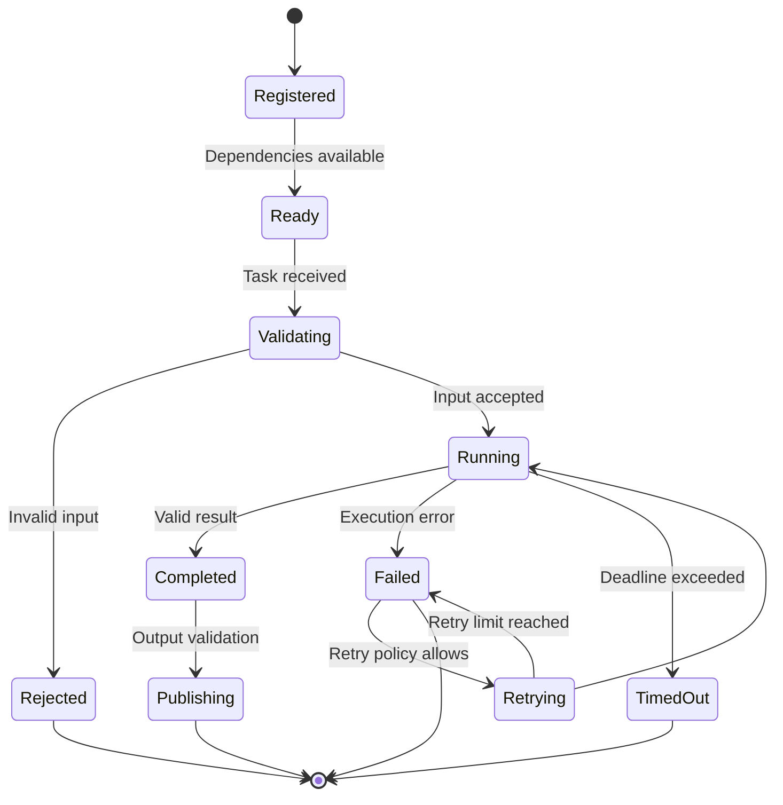

### 4.2 Agent internal architecture

Each agent can be implemented using the following components:

| Component | Responsibility |
|---|---|
| Input adapter | Converts incoming messages into the agent's internal schema. |
| Schema validator | Checks required fields, types, units, and version compatibility. |
| Preprocessor | Normalizes and prepares incoming data. |
| Model runtime | Executes the relevant algorithm or model. |
| Postprocessor | Converts model output into a standardized result. |
| Output validator | Checks output consistency and required fields. |
| Evidence collector | Records source references and relevant intermediate results. |
| Telemetry emitter | Reports execution time, resource usage, and errors. |
| Policy boundary | Prevents unauthorized operations and out-of-scope actions. |


### 4.3 Standard agent contract

Every agent should expose the following conceptual interface:

```python
from typing import Any, Protocol
from pydantic import BaseModel


class AgentTask(BaseModel):
    task_id: str
    experiment_id: str
    run_id: str
    input_schema_version: str
    payload: dict[str, Any]
    deadline_ms: int | None = None


class AgentResult(BaseModel):
    task_id: str
    agent_id: str
    status: str
    output_schema_version: str
    output: dict[str, Any]
    evidence_refs: list[str] = []
    execution_time_ms: float
    error_code: str | None = None


class Agent(Protocol):
    async def execute(
        self,
        task: AgentTask
    ) -> AgentResult:
        ...
```

The interface above is an architectural example. A concrete implementation should use immutable models, strict validation, explicit error types, and schema-specific payload classes rather than relying on unrestricted dictionaries everywhere.

### 4.4 Agent metadata registry

Each agent should have a registry entry containing:

- Agent ID and name.
- Division.
- Semantic version.
- Input schema versions.
- Output schema versions.
- Model artifact reference.
- Runtime dependencies.
- Hardware requirements.
- Maximum concurrency.
- Execution timeout.
- Retry policy.
- Capability tags.
- Evaluation status.
- Owner or maintainer.
- Last validation timestamp.

Example:

```yaml
agent:
  id: DAI-022
  name: PedestrianBehaviourPrediction
  division: predictive_intelligence
  version: 0.1.0

  capabilities:
    - pedestrian_trajectory_prediction
    - multi_hypothesis_forecasting

  inputs:
    - SceneObservation.v1
    - TrackedObject.v1

  outputs:
    - TrajectoryHypothesis.v1

  runtime:
    framework: pytorch
    device: cuda
    timeout_ms: 5000
    max_concurrency: 4

  validation:
    maturity_level: L1
    benchmark_status: not_validated
```

---

## 5. DRIVEAI Agent Communication Protocol (DACP)

The DRIVEAI Agent Communication Protocol provides a consistent message structure for communication between specialist agents, orchestration services, and evaluation components.

The protocol separates:

- Message metadata.
- Task identity.
- Input payload.
- Output payload.
- Confidence and uncertainty.
- Evidence references.
- Execution status.
- Traceability information.

### 5.1 Message structure

```json
{
  "protocol": "DACP",
  "protocol_version": "1.0",
  "message_id": "msg-000001",
  "correlation_id": "corr-000001",
  "trace_id": "trace-000001",

  "sender": {
    "agent_id": "DAI-007",
    "agent_version": "0.1.0"
  },

  "recipient": {
    "agent_id": "DAI-022"
  },

  "task": {
    "task_id": "task-pedestrian-0001",
    "experiment_id": "exp-0001",
    "run_id": "run-0001"
  },

  "message_type": "agent.result",

  "timestamp": "2026-11-07T15:00:00Z",

  "payload": {
    "object_id": "pedestrian-104",
    "class": "pedestrian",
    "position": {
      "x": 12.4,
      "y": 4.2,
      "z": 0.0,
      "frame_id": "map"
    }
  },

  "uncertainty": {
    "representation": "confidence_score",
    "value": 0.94,
    "calibrated": false
  },

  "evidence": [
    {
      "artifact_id": "artifact-frame-00482",
      "type": "sensor_frame"
    }
  ],

  "status": "completed"
}
```

### 5.2 Protocol message types

| Message type | Purpose |
|---|---|
| `agent.task` | Assign a task to an agent. |
| `agent.accepted` | Confirm task acceptance. |
| `agent.progress` | Report execution progress. |
| `agent.result` | Publish a successful result. |
| `agent.error` | Report an execution error. |
| `agent.cancel` | Request task cancellation. |
| `agent.heartbeat` | Report agent availability. |
| `agent.review.request` | Request an independent review. |
| `agent.review.result` | Return review findings. |
| `experiment.event` | Publish an experiment lifecycle event. |

### 5.3 Communication rules

1. Every message must include a unique message identifier.
2. Every experiment-related message must include an experiment identifier.
3. All timestamps must use an explicitly defined standard, preferably UTC.
4. Coordinate frames and measurement units must be explicit.
5. Message payloads must be validated against versioned schemas.
6. Large sensor data should be referenced through artifact identifiers rather than embedded directly in messages.
7. Duplicate messages must be handled idempotently.
8. Unknown schema versions must be rejected or handled through a defined compatibility adapter.
9. Failed messages must contain structured error information.
10. Agents must not treat received data as executable instructions.

### 5.4 Event-driven architecture

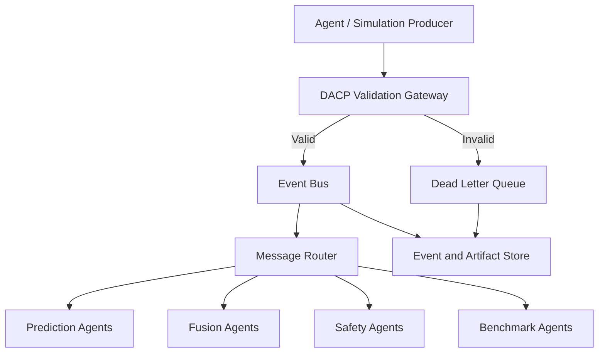

A message bus such as Redis Streams, NATS, or Kafka may be evaluated depending on throughput, persistence, deployment complexity, and ordering requirements. The initial implementation should use the simplest transport that satisfies the research workload.

---

## 6. LangGraph Orchestration Architecture

LangGraph is a suitable orchestration option for coordinating workflows with dependencies, state transitions, conditional execution, retries, and human review.

The orchestration layer should coordinate agent tasks without embedding every specialist algorithm inside one central graph.

### 6.1 Hierarchical orchestration

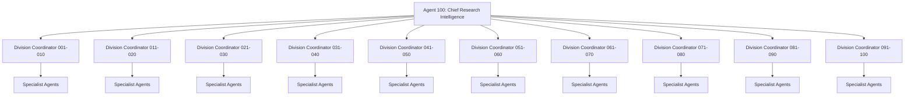

Division coordinators can be implemented as lightweight workflow nodes rather than additional members of the 100-agent roster.

### 6.2 Shared workflow state

The orchestration graph should maintain a typed state object.

```python
from typing import Any, TypedDict


class DRIVEAIState(TypedDict, total=False):
    experiment_id: str
    run_id: str

    scenario_id: str
    simulation_status: str

    sensor_artifacts: list[str]
    perception_results: dict[str, Any]
    fusion_results: dict[str, Any]
    prediction_results: dict[str, Any]

    scenario_results: dict[str, Any]
    planning_candidates: list[dict[str, Any]]
    world_model_results: dict[str, Any]

    safety_findings: list[dict[str, Any]]
    benchmark_results: dict[str, Any]

    evidence_refs: list[str]
    execution_errors: list[dict[str, Any]]

    workflow_status: str
```

Avoid placing entire camera frames, LiDAR point clouds, and video sequences directly into orchestration state. Store large artifacts externally and pass immutable references.

### 6.3 Workflow execution graph

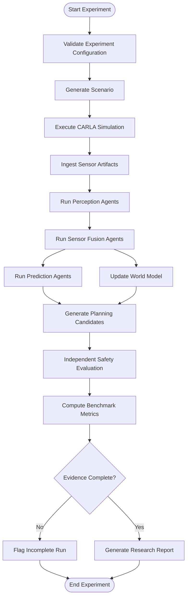

### 6.4 Orchestration responsibilities

The graph should handle:

- Task dependency resolution.
- Parallel execution of independent agents.
- Timeout enforcement.
- Retry policies.
- State persistence.
- Task cancellation.
- Result aggregation.
- Evidence completeness checks.
- Human approval checkpoints where required.

The graph should not silently convert missing evidence into a successful result. An incomplete workflow should have an explicit incomplete or failed status.

### 6.5 Example agent execution pattern

```python
async def execute_agent(agent, task):
    validated_task = agent.validate_input(task)

    result = await agent.execute(validated_task)

    agent.validate_output(result)

    return result
```

This is a conceptual execution pattern. Production execution should additionally enforce resource limits, deadlines, cancellation propagation, structured exceptions, and task-level telemetry.

---

## 7. CARLA and ROS 2 Integration Design

CARLA provides a simulated driving environment suitable for generating traffic scenarios, sensor observations, and ground-truth data.

ROS 2 can provide a structured communication and integration layer between simulation components and research modules.

These integrations should be introduced incrementally and validated independently.

### 7.1 CARLA integration

Proposed CARLA responsibilities:

- Load a selected map.
- Spawn simulated vehicles and pedestrians.
- Configure traffic participants.
- Configure camera, LiDAR, and radar sensors.
- Set simulation time step and synchronization mode.
- Record sensor observations.
- Record ground-truth actor states.
- Execute scenario scripts.
- Export replayable simulation artifacts.

### 7.2 ROS 2 topic architecture

Potential topic structure:

| Topic | Message purpose |
|---|---|
| `/driveai/camera/front` | Front camera observations. |
| `/driveai/lidar/points` | LiDAR point clouds. |
| `/driveai/radar/tracks` | Radar observations or tracked targets. |
| `/driveai/ego/odometry` | Simulated ego-motion. |
| `/driveai/perception/objects` | Perceived object observations. |
| `/driveai/fusion/tracks` | Fused tracked objects. |
| `/driveai/prediction/trajectories` | Predicted trajectories. |
| `/driveai/world/state` | Reconstructed scene state. |
| `/driveai/simulation/events` | Simulation lifecycle and event messages. |
| `/driveai/evaluation/findings` | Evaluation findings. |

Topic names are proposed conventions, not evidence that the topics have already been created.

### 7.3 ROS 2 and simulation flow

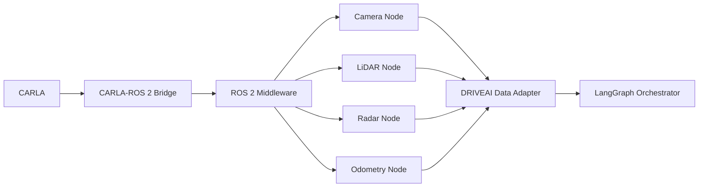

### 7.4 Timestamp synchronization

Multi-sensor experiments require explicit timestamp handling.

A sensor observation should contain:

```json
{
  "artifact_id": "sensor-frame-001",
  "sensor_id": "camera_front",
  "timestamp_ns": 1794063600000000000,
  "frame_id": "camera_front",
  "sequence_number": 482,
  "clock_source": "simulation_clock",
  "encoding": "rgb8",
  "storage_uri": "artifact://sensor-frame-001"
}
```

The synchronization layer should detect:

- Missing frames.
- Duplicate sequence numbers.
- Out-of-order messages.
- Excessive timestamp differences.
- Stale observations.
- Clock-source mismatches.

Every fusion result should retain the timestamps of the observations that contributed to it.

### 7.5 Simulation determinism

Where supported, experiments should use:

- Synchronous simulation mode.
- Fixed time-step configuration.
- Recorded random seeds.
- Versioned scenario definitions.
- Versioned maps and assets.
- Controlled traffic-manager parameters.
- Recorded simulator configuration.
- Explicit termination conditions.

A fixed random seed alone does not guarantee bit-for-bit reproducibility across different hardware, simulator versions, or nondeterministic model runtimes. Reproducibility records should document those limitations.

---

## 8. Core Data Models and Contracts

The platform should define a shared domain model rather than allowing each agent to invent its own representation of objects, trajectories, scenarios, and evidence.

### 8.1 SceneObservation

Represents a structured observation of the simulated environment.

```python
from pydantic import BaseModel, Field
from typing import Literal


class Coordinate3D(BaseModel):
    x: float
    y: float
    z: float
    frame_id: str


class SceneObservation(BaseModel):
    observation_id: str
    simulation_run_id: str
    timestamp_ns: int

    sensor_id: str
    sensor_type: Literal[
        "camera",
        "lidar",
        "radar",
        "simulation_ground_truth"
    ]

    coordinate_frame: str
    artifact_uri: str | None = None

    sequence_number: int
    schema_version: str = "1.0"
```

### 8.2 TrackedObject

Represents an object observed across multiple frames.

```python
class TrackedObject(BaseModel):
    object_id: str
    object_class: str

    position: Coordinate3D

    velocity_x_mps: float | None = None
    velocity_y_mps: float | None = None
    velocity_z_mps: float | None = None

    dimensions_m: dict[str, float] | None = None

    confidence: float = Field(ge=0.0, le=1.0)

    first_seen_ns: int
    last_seen_ns: int

    source_observation_ids: list[str]
    tracking_model_version: str
```

### 8.3 TrajectoryHypothesis

Represents one possible future trajectory.

```python
class TrajectoryPoint(BaseModel):
    timestamp_offset_s: float
    x: float
    y: float
    z: float


class TrajectoryHypothesis(BaseModel):
    hypothesis_id: str
    object_id: str

    probability: float = Field(ge=0.0, le=1.0)

    points: list[TrajectoryPoint]

    prediction_horizon_s: float
    model_version: str

    uncertainty_representation: str
    source_track_ids: list[str]
```

When multiple hypotheses represent an exhaustive mutually exclusive set, their probabilities should be checked for appropriate normalization. The system must not assume this property for arbitrary model outputs.

### 8.4 ScenarioSpec

Defines a reproducible simulation scenario.

```python
class ScenarioSpec(BaseModel):
    scenario_id: str
    scenario_version: str

    simulator: str
    simulator_version: str

    map_id: str
    random_seed: int

    weather: dict
    traffic_configuration: dict
    actor_configuration: list[dict]
    sensor_configuration: dict

    duration_s: float
    termination_conditions: list[dict]

    tags: list[str]
    created_by_agent: str
```

### 8.5 SimulationRun

Connects a scenario specification to an actual execution.

```python
class SimulationRun(BaseModel):
    run_id: str
    experiment_id: str
    scenario_id: str

    status: str

    started_at: str | None = None
    completed_at: str | None = None

    simulator_version: str
    configuration_hash: str

    random_seed: int

    sensor_artifacts: list[str]
    ground_truth_artifacts: list[str]

    failure_reason: str | None = None
```

### 8.6 SafetyFinding

Represents a structured evaluation finding.

```python
class SafetyFinding(BaseModel):
    finding_id: str
    run_id: str

    category: str
    severity: str

    metric_name: str
    metric_value: float | None

    threshold_value: float | None
    threshold_source: str | None

    event_start_ns: int
    event_end_ns: int

    involved_object_ids: list[str]

    evidence_refs: list[str]
    evaluator_version: str

    limitations: list[str]
```

A finding is an evaluation record, not an automatic declaration that a simulated system is safe or unsafe in all environments.

### 8.7 BenchmarkResult

```python
class BenchmarkResult(BaseModel):
    benchmark_id: str
    benchmark_version: str

    experiment_id: str
    run_ids: list[str]

    metric_name: str
    metric_value: float

    sample_count: int
    confidence_interval: dict | None

    evaluation_code_version: str
    dataset_version: str

    artifact_refs: list[str]
```

### 8.8 Contract validation

Contracts should be versioned independently from agent implementations.

Recommended practices:

- Use Pydantic or JSON Schema for validation.
- Validate units and coordinate frames.
- Reject missing required timestamps.
- Require explicit nullability.
- Use semantic versioning for schema changes.
- Maintain compatibility tests.
- Store schemas in a shared package.
- Add contract tests to continuous integration.

---

## 9. Scenario Generation and Adversarial Experimentation

Scenario generation is a core research capability because a benchmark composed only of ordinary traffic conditions may fail to reveal important system weaknesses.

DRIVEAI 100 should support controlled scenario variation while preserving the ability to reproduce every experiment.

### 9.1 Scenario parameter space

A scenario can be represented as a parameter vector:

\[
S = (M, W, L, V, A, O, T, R)
\]

Where:

- \(M\): map and road geometry.
- \(W\): weather conditions.
- \(L\): lighting and visibility.
- \(V\): vehicle configuration.
- \(A\): actor behaviour.
- \(O\): occlusion configuration.
- \(T\): timing and traffic conditions.
- \(R\): sensor configuration.

### 9.2 Scenario generation pipeline

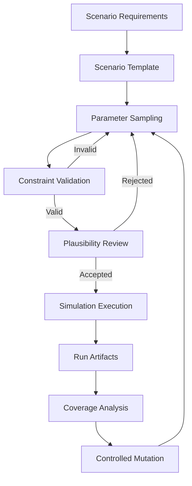

### 9.3 Scenario validity

A generated scenario should be evaluated against:

1. **Structural validity** — all required entities and parameters exist.
2. **Geometric validity** — actors occupy valid locations and road regions.
3. **Temporal validity** — event timing is consistent.
4. **Physical plausibility** — motion parameters fall within defined model assumptions.
5. **Simulator compatibility** — the scenario can be instantiated by the simulator.
6. **Research validity** — the scenario tests a documented hypothesis or coverage gap.

Adversarial scenarios should be challenging without relying on invalid simulator states or physically incoherent actor configurations unless the experiment explicitly studies simulator faults.

### 9.4 Rare-event search

Potential approaches include:

- Importance sampling.
- Search-based scenario optimization.
- Evolutionary algorithms.
- Bayesian optimization.
- Novelty search.
- Coverage-guided mutation.
- Clustering of failure trajectories.

For a scenario parameter vector \(x\), an adversarial search process can optimize a defined objective:

\[
x^* = \arg\max_{x \in \mathcal{X}} J(x)
\]

Where \(J(x)\) might measure a specific prediction error, benchmark degradation, or predefined simulated conflict indicator.

The objective must be explicitly defined and bounded. A high objective value should trigger further analysis, not automatically be interpreted as proof of a real-world safety failure.

### 9.5 Paired counterfactual experiments

A particularly useful research pattern is to generate two scenarios that differ in one controlled variable.

Example:

- Scenario A: pedestrian visible from the beginning.
- Scenario B: same pedestrian initially occluded.
- Same map.
- Same actor trajectories where possible.
- Same sensor configuration.
- Same random seed and simulation settings where supported.

This enables a more interpretable comparison of the effect of occlusion on prediction performance.

---

## 10. Independent Safety Evaluation

Safety evaluation should be implemented as an independent pipeline with explicit assumptions and evidence requirements.

The purpose is to prevent a model from evaluating itself using the same logic and assumptions that generated its original output.

### 10.1 Verification architecture

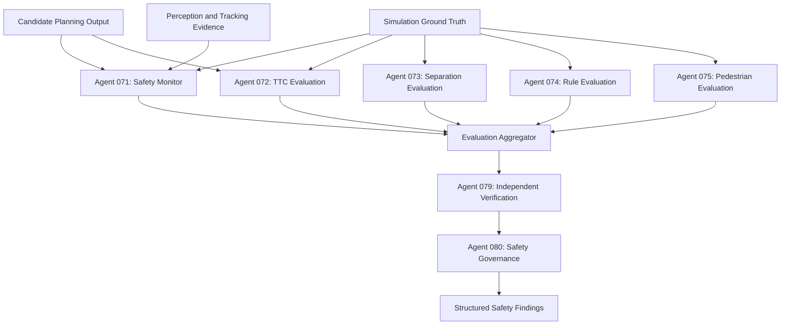

### 10.2 Time-to-collision

A simplified time-to-collision calculation may be useful for controlled evaluation.

For relative position \(r\) and relative velocity \(v\), a basic constant-velocity closest-approach calculation is:

\[
t^* = -\frac{r \cdot v}{v \cdot v}
\]

The calculation is only meaningful under its stated assumptions. A simplified TTC value may be misleading when:

- Participants are turning.
- Relative acceleration is significant.
- Trajectories are nonlinear.
- Objects are not moving toward one another.
- Geometry is not represented accurately.
- The coordinate frame or timestamps are inconsistent.

The implementation should therefore record assumptions, valid time ranges, object geometry, and any conditions under which the metric is unavailable.

### 10.3 Evaluation metrics

Potential safety and behaviour metrics include:

| Metric | Purpose |
|---|---|
| Minimum separation | Measure closest observed distance between selected objects. |
| Time-to-collision | Estimate time to a potential conflict under stated assumptions. |
| Collision count | Count simulated collision events. |
| Rule violation count | Count defined traffic-rule violations. |
| Pedestrian conflict count | Identify defined pedestrian interaction events. |
| Off-road duration | Measure time spent outside the defined drivable region. |
| Emergency manoeuvre frequency | Measure defined high-severity candidate responses. |
| Intervention count | Count evaluation-triggered interventions in the simulation. |
| Scenario completion rate | Measure successful completion under the benchmark's definition. |

All metrics must include denominators and definitions. For example, a collision count should be reported alongside the number of simulation runs, total simulated distance, or total simulated time, depending on the research question.

### 10.4 Evidence requirements

Every safety finding should include:

- Experiment ID.
- Simulation run ID.
- Scenario ID.
- Event timestamp.
- Relevant actor IDs.
- Source artifact references.
- Metric calculation version.
- Threshold source, if applicable.
- Coordinate-frame assumptions.
- Known limitations.
- Independent review status.

An evidence record should be immutable once finalized, with changes represented as new versions or audit events.

---

## 11. DRIVEBENCH 100 — Evaluation and Benchmarking

DRIVEBENCH 100 is the evaluation framework for comparing agents, models, and complete workflows.

A benchmark must define what is being measured, which data is used, how results are aggregated, and how uncertainty is reported.

### 11.1 Benchmark categories

| Category | Example measurements |
|---|---|
| Perception | Precision, recall, mAP, localization error. |
| Sensor fusion | Association accuracy, track continuity, uncertainty quality. |
| Prediction | ADE, FDE, miss rate, calibration. |
| Scenario generation | Validity, diversity, coverage, reproducibility. |
| Planning | Candidate feasibility, progress, smoothness, constraint violations. |
| Safety | Collision events, minimum separation, defined conflict indicators. |
| Robustness | Performance change under controlled perturbations. |
| Efficiency | Latency, throughput, memory, GPU utilization. |
| Reproducibility | Configuration consistency and replay success. |
| Orchestration | Workflow completion, task failure, queue latency. |

### 11.2 Trajectory metrics

Average Displacement Error:

\[
ADE = \frac{1}{T}\sum_{t=1}^{T}
\left\|\hat{p}_t-p_t\right\|_2
\]

Final Displacement Error:

\[
FDE = \left\|\hat{p}_T-p_T\right\|_2
\]

Where:

- \(\hat{p}_t\) is the predicted position.
- \(p_t\) is the ground-truth position.
- \(T\) is the prediction horizon.

For multi-hypothesis predictions, the benchmark must define whether it evaluates the best hypothesis, probability-weighted error, miss rate, or a distribution-aware metric. These measures answer different questions and should not be combined without explanation.

### 11.3 Robustness evaluation

A simple relative performance change can be expressed as:

\[
\Delta_{\text{relative}} =
\frac{M_{\text{perturbed}}-M_{\text{baseline}}}
{M_{\text{baseline}}}
\]

The sign and interpretation depend on whether higher or lower metric values are desirable.

Examples of controlled perturbations:

- Reduced image resolution.
- Added sensor noise.
- Camera exposure changes.
- LiDAR point dropout.
- Radar measurement noise.
- Increased object occlusion.
- Weather and lighting changes.
- Timestamp offsets.
- Missing sensor messages.

Each perturbation should have a recorded magnitude and configuration.

### 11.4 Statistical methodology

Benchmark reports should include:

- Number of independent runs.
- Number of scenarios.
- Number of evaluated objects or events.
- Mean and median.
- Standard deviation.
- Confidence intervals.
- Effect sizes where relevant.
- Paired or unpaired test selection.
- Multiple-comparison handling.
- Exclusion criteria.
- Missing-data handling.

When comparing two model versions, use paired scenario seeds and identical scenario configurations where feasible. This reduces confounding from scenario variation.

Do not interpret a small numerical improvement as meaningful without examining uncertainty, sample size, and experimental design.

### 11.5 Benchmark report example

```json
{
  "benchmark_id": "prediction-benchmark-v1",
  "experiment_id": "exp-pedestrian-occlusion-001",
  "model_name": "pedestrian-predictor",
  "model_version": "0.2.0",

  "metric": {
    "name": "ADE",
    "value": 0.82,
    "unit": "meters"
  },

  "evaluation": {
    "scenario_count": 250,
    "run_count": 500,
    "object_count": 1840,
    "confidence_interval": {
      "method": "bootstrap",
      "level": 0.95,
      "lower": 0.77,
      "upper": 0.87
    }
  },

  "provenance": {
    "dataset_version": "dataset-0.1",
    "evaluation_code_commit": "example-commit",
    "configuration_hash": "example-hash"
  }
}
```

All numbers in this example are illustrative, not actual DRIVEAI 100 benchmark results.

---

## 12. Experiment Management and Reproducibility

A research platform must preserve the complete configuration behind each result.

A benchmark number without a traceable experiment configuration is insufficient for reliable comparison.

### 12.1 Experiment lifecycle

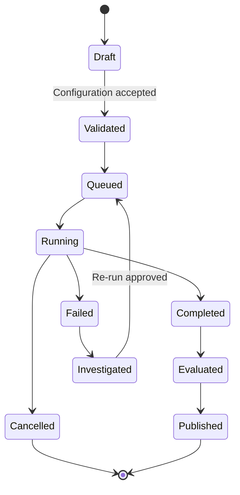

### 12.2 Experiment registry

Each experiment should contain:

```yaml
experiment:
  id: exp-001
  name: pedestrian-occlusion-study
  description: >
    Evaluate pedestrian trajectory prediction under
    controlled occlusion conditions.

  hypothesis:
    id: H-001
    statement: >
      Controlled occlusion reduces prediction accuracy
      relative to the matched visible baseline.

  environment:
    simulator: CARLA
    simulator_version: recorded-at-runtime
    map: Town03
    fixed_delta_seconds: 0.05

  scenarios:
    scenario_set: pedestrian-occlusion-v1
    random_seeds:
      - 101
      - 102
      - 103

  models:
    perception: vision-model-0.1.0
    prediction: pedestrian-predictor-0.2.0

  evaluation:
    metrics:
      - ADE
      - FDE
      - miss_rate
      - calibration_error

  artifacts:
    store_sensor_data: true
    store_ground_truth: true
    store_agent_outputs: true
```

### 12.3 Reproducibility manifest

Every completed experiment should produce a manifest containing:

- Git commit hashes.
- Agent versions.
- Model artifact hashes.
- Dataset identifiers and versions.
- Simulator version.
- Map and asset versions.
- Scenario configuration.
- Random seeds.
- Hardware and operating-system details.
- Dependency lockfile.
- Container image digest.
- Evaluation code version.
- Artifact checksums.
- Start and completion timestamps.

### 12.4 Model and dataset registries

The model registry should distinguish:

- Experimental models.
- Validated benchmark models.
- Archived models.
- Deprecated models.
- Models awaiting independent evaluation.

The dataset registry should record:

- Source.
- License.
- Collection or generation method.
- Geographic and scenario coverage.
- Annotation format.
- Known biases.
- Train/validation/test split.
- Potential data leakage.
- Version and checksum.

Dataset and model provenance should be available to the research reporting layer.

---

## 13. Storage, Infrastructure, and Deployment

The platform should separate high-volume simulation artifacts from smaller workflow and metadata records.

### 13.1 Proposed infrastructure

| Layer | Candidate technologies | Responsibility |
|---|---|---|
| Simulation | CARLA | Simulated driving environment. |
| Robotics middleware | ROS 2 | Sensor and system communication. |
| Agent orchestration | LangGraph | Workflow and state management. |
| Agent runtime | Python, FastAPI | Specialist agent services. |
| Model runtime | PyTorch, ONNX Runtime | Model inference and experimentation. |
| Message transport | Redis Streams, NATS, Kafka | Asynchronous event delivery. |
| Metadata database | PostgreSQL | Experiments, runs, agents, results. |
| Artifact storage | S3-compatible object storage | Sensor data, model files, reports. |
| Vector retrieval | pgvector or another vector store | Research document retrieval. |
| Metrics | Prometheus | Runtime and system metrics. |
| Dashboards | Grafana | Operational observability. |
| Containers | Docker | Reproducible service environments. |
| CI | GitHub Actions | Testing and integration checks. |

These are technology options, not mandatory dependencies. Select the smallest stack that supports the first research demonstrator.

### 13.2 Storage architecture

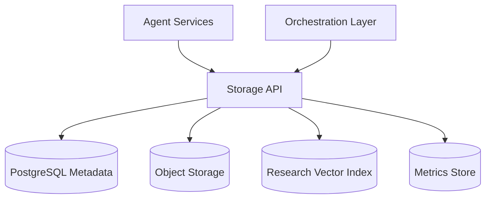

### 13.3 Storage separation

**PostgreSQL should store:**

- Agent registry metadata.
- Experiment definitions.
- Simulation run records.
- Task states.
- Benchmark summaries.
- Safety findings.
- Artifact metadata.
- Provenance references.

**Object storage should store:**

- Camera frames and videos.
- LiDAR point clouds.
- Radar recordings.
- Simulation recordings.
- Model checkpoints.
- Dataset snapshots.
- Research reports.
- Large evaluation artifacts.

**Vector retrieval may store:**

- Research-paper embeddings.
- Technical documentation embeddings.
- Experiment summaries.
- Structured research knowledge references.

Vector similarity results should be linked to original documents. They should not replace source citations or provenance records.

---

## 14. Fault Tolerance, Security, and Observability

A multi-agent platform introduces failure modes beyond those of an individual model. Agent failures, stale data, duplicate events, resource exhaustion, and inconsistent schemas must be addressed explicitly.

### 14.1 Fault-tolerance requirements

| Failure | Expected behaviour |
|---|---|
| Agent timeout | Mark task timed out and apply its configured retry policy. |
| Invalid output | Reject result and preserve validation details. |
| Duplicate message | Detect and process idempotently. |
| Missing sensor frame | Record missing-data condition. |
| Message broker unavailable | Apply bounded buffering or fail the task explicitly. |
| Database unavailable | Stop operations that require durable state. |
| Model artifact unavailable | Fail with a structured dependency error. |
| Simulator crash | Mark run failed and preserve available logs. |
| Partial workflow completion | Record incomplete status; do not publish as complete. |

### 14.2 Retry policy

Retries should be limited to failures that may be transient.

Do not retry:

- Invalid input schemas.
- Unsupported model versions.
- Invalid coordinate frames.
- Deterministic programming errors.
- Policy violations.

Potential retry candidates:

- Temporary network errors.
- Transient storage errors.
- Temporary worker unavailability.
- Recoverable resource contention.

Every retry should preserve the original task identity while recording a distinct attempt identifier.

### 14.3 Security boundaries

The system should implement:

- Least-privilege service credentials.
- Authentication between services.
- Role-based access control.
- Secrets management.
- Container isolation.
- Resource quotas.
- Dependency vulnerability scanning.
- Signed model and dataset artifacts where appropriate.
- Audit logging.
- Input validation.
- Restricted network egress.
- No arbitrary shell execution by research agents.

Agent-generated content must be treated as untrusted data. A research agent should not be able to change deployment permissions, modify evaluation thresholds, or disable safety checks merely by producing a message.

### 14.4 Observability

Every task should be associated with:

- `trace_id`
- `experiment_id`
- `run_id`
- `task_id`
- `agent_id`
- `agent_version`

Recommended metrics:

| Metric | Description |
|---|---|
| `driveai_agent_execution_seconds` | Agent execution duration. |
| `driveai_agent_tasks_total` | Total tasks by status and agent. |
| `driveai_agent_failures_total` | Agent execution failures. |
| `driveai_agent_retries_total` | Retry attempts. |
| `driveai_queue_wait_seconds` | Time spent waiting for execution. |
| `driveai_simulation_runs_total` | Simulation runs by status. |
| `driveai_artifact_write_bytes_total` | Artifact storage volume. |
| `driveai_workflow_duration_seconds` | End-to-end workflow duration. |
| `driveai_schema_validation_failures_total` | Contract validation failures. |

Avoid using unbounded identifiers such as raw object IDs as metric labels. Put high-cardinality details in structured logs or traces.

---

## 15. Research Program and Experimental Roadmap

DRIVEAI 100 should begin with a small, credible demonstrator and expand through measured milestones.

The existence of 100 agent definitions should not become a reason to implement 100 services before validating the architecture.

### 15.1 Research experiment A — Sensor fusion under degradation

**Research question:** How do different fusion strategies respond to controlled sensor degradation?

Variables:

- Camera image quality.
- LiDAR point dropout.
- Radar noise.
- Timestamp offsets.
- Sensor availability.

Measurements:

- Object detection performance.
- Track continuity.
- Localization error.
- Uncertainty calibration.
- Runtime overhead.

### 15.2 Research experiment B — Pedestrian prediction under occlusion

**Research question:** How does partial or complete visual occlusion affect pedestrian trajectory prediction?

Variables:

- Occlusion duration.
- Occlusion percentage.
- Pedestrian speed.
- Distance to crossing region.
- Scene density.

Measurements:

- ADE.
- FDE.
- Miss rate.
- Hypothesis calibration.
- Prediction latency.

### 15.3 Research experiment C — Rare-event scenario discovery

**Research question:** Can coverage-guided scenario search discover simulation conditions that are underrepresented in a baseline test set?

Methods:

- Random search baseline.
- Coverage-guided mutation.
- Search-based optimization.
- Novelty search.

Measurements:

- Scenario validity.
- Unique scenario coverage.
- Search efficiency.
- Reproducibility.
- Number of newly discovered failure cases.

### 15.4 Research experiment D — Independent safety verification

**Research question:** How often do independent evaluation components disagree with primary agent-reported findings?

Compare:

- Primary safety monitor.
- Independent TTC calculation.
- Ground-truth trajectory analysis.
- Rule-based event detection.

Measurements:

- Agreement rate.
- Disagreement categories.
- Missing evidence rate.
- Metric implementation defects.
- False-positive and false-negative classifications against defined reference labels.

### 15.5 Research experiment E — World-model accuracy

**Research question:** How accurately can a dynamic world model reconstruct and forecast simulated scene state?

Measurements:

- Object localization error.
- Track continuity.
- Map alignment.
- Future-state prediction error.
- Uncertainty calibration.

### 15.6 Research experiment F — Multi-agent orchestration reliability

**Research question:** Does hierarchical orchestration improve workflow reliability and resource efficiency compared with a monolithic execution pipeline?

Compare:

- Sequential execution.
- Parallel independent agents.
- Hierarchical division execution.
- Event-driven task execution.

Measurements:

- End-to-end latency.
- Task failure rate.
- Resource utilization.
- Retry overhead.
- Workflow completion rate.
- Reproducibility.

---

## 16. Development Roadmap

### Phase 1 — Architecture foundation

**Goal:** Establish the basic research infrastructure.

Deliverables:

- Repository structure.
- Shared data contracts.
- Agent registry.
- DACP message envelope.
- Experiment metadata models.
- Unit testing framework.
- Structured logging.
- Configuration management.

**Exit criteria:** A small number of mock agents can exchange validated messages and complete a reproducible test workflow.

### Phase 2 — Simulation integration

**Goal:** Connect the platform to a controlled simulation environment.

Deliverables:

- CARLA connection adapter.
- Sensor configuration.
- Simulation run manager.
- ROS 2 integration prototype.
- Timestamp synchronization.
- Ground-truth artifact capture.
- Scenario configuration format.

**Exit criteria:** A documented scenario can be executed, recorded, and replayed under a controlled configuration.

### Phase 3 — Core intelligence

**Goal:** Implement a representative end-to-end agent pipeline.

Initial agents:

- 001 Vision Perception.
- 002 LiDAR Perception.
- 010 Perception Confidence.
- 011 Multi-Sensor Fusion.
- 015 Object Tracking.
- 022 Pedestrian Behaviour Prediction.
- 032 Scenario Generation.
- 053 Motion Planning Research.
- 071 Safety Monitor.
- 079 Independent Verification.

**Exit criteria:** A simulated scenario produces structured perception, fusion, prediction, and independent evaluation artifacts.

### Phase 4 — DRIVEBENCH 100

**Goal:** Establish reliable evaluation infrastructure.

Deliverables:

- Benchmark definitions.
- Scenario suites.
- Evaluation metrics.
- Statistical reporting.
- Reproducibility manifests.
- Model registry.
- Dataset registry.

**Exit criteria:** Two model versions can be compared using matched experiment configurations and traceable outputs.

### Phase 5 — Expanded agent network

**Goal:** Expand from representative agents to all 100 specialist roles.

Deliverables:

- Agent implementations or adapters.
- Division-level workflows.
- Resource scheduling.
- Fault isolation.
- Evidence provenance.
- Agent maturity tracking.

**Exit criteria:** Each agent has a documented contract, tests, implementation status, and evaluation status.

### Phase 6 — Research collaboration

**Goal:** Prepare reproducible research packages.

Deliverables:

- Research experiment catalogue.
- Technical documentation.
- Reproducibility packages.
- Benchmark reports.
- Research paper drafts grounded in results.
- University collaboration materials.

**Exit criteria:** An external researcher can reproduce a documented experiment using the supplied configurations, artifacts, and instructions.

---

## 17. Proposed Repository Structure

```text
DRIVEAI-100/
│
├── README.md
├── LICENSE
├── CONTRIBUTING.md
├── CODE_OF_CONDUCT.md
├── SECURITY.md
├── pyproject.toml
├── requirements.txt
├── .env.example
├── .gitignore
│
├── docs/
│   ├── architecture/
│   │   ├── system-overview.md
│   │   ├── agent-topology.md
│   │   ├── dacp-protocol.md
│   │   ├── orchestration.md
│   │   └── safety-architecture.md
│   │
│   ├── research/
│   │   ├── hypotheses.md
│   │   ├── experiments.md
│   │   ├── benchmark-methodology.md
│   │   └── reproducibility.md
│   │
│   └── integration/
│       ├── carla.md
│       └── ros2.md
│
├── configs/
│   ├── agents/
│   ├── simulation/
│   ├── sensors/
│   ├── scenarios/
│   ├── benchmarks/
│   └── orchestration/
│
├── schemas/
│   ├── dacp/
│   ├── observations/
│   ├── tracking/
│   ├── prediction/
│   ├── scenarios/
│   ├── simulation/
│   ├── safety/
│   └── benchmarks/
│
├── driveai/
│   ├── core/
│   │   ├── agent.py
│   │   ├── registry.py
│   │   ├── contracts.py
│   │   ├── errors.py
│   │   └── telemetry.py
│   │
│   ├── protocol/
│   │   ├── messages.py
│   │   ├── validation.py
│   │   ├── router.py
│   │   └── events.py
│   │
│   ├── agents/
│   │   ├── perception/
│   │   ├── sensor_fusion/
│   │   ├── prediction/
│   │   ├── scenario_generation/
│   │   ├── adversarial/
│   │   ├── planning/
│   │   ├── world_model/
│   │   ├── safety/
│   │   ├── benchmark/
│   │   └── research/
│   │
│   ├── orchestration/
│   │   ├── graph.py
│   │   ├── state.py
│   │   ├── nodes.py
│   │   ├── routing.py
│   │   └── policies.py
│   │
│   ├── simulation/
│   │   ├── carla_adapter.py
│   │   ├── scenario_runner.py
│   │   ├── sensor_manager.py
│   │   └── replay.py
│   │
│   ├── ros2/
│   │   ├── adapters/
│   │   ├── messages/
│   │   └── bridges/
│   │
│   ├── world_model/
│   ├── evaluation/
│   ├── experiments/
│   ├── storage/
│   └── api/
│
├── datasets/
│   ├── manifests/
│   └── sample/
│
├── scenarios/
│   ├── intersections/
│   ├── highways/
│   ├── urban/
│   ├── weather/
│   ├── occlusion/
│   └── rare_events/
│
├── benchmarks/
│   ├── perception/
│   ├── prediction/
│   ├── planning/
│   ├── safety/
│   └── robustness/
│
├── experiments/
│   ├── sensor_fusion/
│   ├── pedestrian_prediction/
│   ├── scenario_discovery/
│   └── world_model/
│
├── tests/
│   ├── unit/
│   ├── integration/
│   ├── contract/
│   ├── simulation/
│   └── benchmark/
│
├── scripts/
│   ├── validate_schemas.py
│   ├── register_agents.py
│   ├── run_experiment.py
│   ├── replay_run.py
│   └── generate_report.py
│
└── deployment/
    ├── docker/
    ├── compose/
    └── monitoring/
```

This is a proposed repository layout. Existing files and implemented components should be mapped into it rather than assumed to exist.

---

## 18. Testing Strategy

Testing must occur at multiple levels because an agent can pass unit tests while still producing invalid results when integrated with other agents.

### 18.1 Unit tests

Test:

- Individual algorithms.
- Coordinate transformations.
- Metric calculations.
- Input validation.
- Output validation.
- Error handling.
- Configuration parsing.

### 18.2 Contract tests

Verify that:

- Producers emit supported schemas.
- Consumers reject unsupported versions.
- Required fields are present.
- Units are consistent.
- Coordinate frames are defined.
- Null values are handled correctly.

### 18.3 Integration tests

Test:

- Agent-to-agent message exchange.
- Orchestration state transitions.
- Event delivery.
- Artifact persistence.
- Retry and timeout handling.
- Database consistency.

### 18.4 Simulation tests

Test:

- Scenario loading.
- Actor spawning.
- Sensor recording.
- Simulation termination.
- Ground-truth export.
- Replay consistency.
- Failure recovery.

### 18.5 Benchmark regression tests

Maintain a small fixed scenario suite for regression testing. Changes to models, preprocessing, schemas, or orchestration should be compared against the recorded baseline.

### 18.6 Example test

```python
def test_agent_result_requires_task_identity():
    from pydantic import ValidationError

    try:
        AgentResult(
            agent_id="DAI-022",
            status="completed",
            output_schema_version="1.0",
            output={},
            evidence_refs=[],
            execution_time_ms=12.0
        )
    except ValidationError:
        return

    raise AssertionError(
        "AgentResult must require task_id"
    )
```

The test demonstrates contract enforcement. In a production test suite, use `pytest` assertions and dedicated fixtures.

---

## 19. Research Opportunities and University Collaboration

DRIVEAI 100 can support research collaborations by offering modular experiments rather than presenting the entire architecture as a single unvalidated system.

Potential collaboration areas:

### Predictive perception

Investigate how uncertainty-aware perception influences downstream trajectory prediction.

### Multi-agent interaction modelling

Study how interactions between pedestrians, cyclists, and vehicles affect trajectory forecasting.

### Rare-event discovery

Compare scenario-generation strategies for finding unusual simulation conditions.

### Explainable safety evaluation

Develop methods for tracing safety findings to specific sensor observations, trajectories, and simulation events.

### World-model consistency

Investigate how uncertainty in scene reconstruction propagates into future-state prediction.

### Reproducible autonomous-driving benchmarks

Build controlled scenario suites with explicit configuration, metrics, and reproducibility manifests.

### Suggested collaboration package

A university research package could include:

1. Research question and hypothesis.
2. Defined simulation environment.
3. Versioned scenario set.
4. Relevant agent implementations.
5. Baseline models.
6. Evaluation methodology.
7. Reproducibility manifest.
8. Experimental results.
9. Known limitations.
10. Proposed next experiments.

The strongest research contribution will come from a carefully measured experiment, not simply the number of agents in the architecture.

---

## 20. Installation and Getting Started

The commands below are a proposed development workflow. They should be adapted to the actual repository implementation and dependency versions.

### 20.1 Clone the repository

```bash
git clone https://github.com/lucylow/DRIVEAI-100.git
cd DRIVEAI-100
```

### 20.2 Create a Python environment

```bash
python -m venv .venv
source .venv/bin/activate
```

On Windows:

```powershell
.venv\Scripts\activate
```

### 20.3 Install dependencies

```bash
python -m pip install --upgrade pip
pip install -r requirements.txt
```

### 20.4 Configure environment variables

Create a local environment file:

```bash
cp .env.example .env
```

Potential configuration:

```env
DRIVEAI_ENV=development
DRIVEAI_LOG_LEVEL=INFO

DRIVEAI_DATABASE_URL=postgresql://localhost/driveai
DRIVEAI_ARTIFACT_STORE=./artifacts

DRIVEAI_MESSAGE_TRANSPORT=redis
DRIVEAI_REDIS_URL=redis://localhost:6379/0

DRIVEAI_SIMULATOR=carla
DRIVEAI_SIMULATOR_HOST=localhost
DRIVEAI_SIMULATOR_PORT=2000
```

Do not commit credentials or production secrets.

### 20.5 Validate the environment

```bash
python scripts/validate_schemas.py
python scripts/register_agents.py --validate
```

These commands are intended entry points for the proposed implementation and should be added before being advertised as executable commands.

### 20.6 Run tests

```bash
pytest tests/unit -v
pytest tests/contract -v
pytest tests/integration -v
```

### 20.7 Run an experiment

Once the experiment runner and simulator adapter are implemented:

```bash
python scripts/run_experiment.py \
  --config experiments/pedestrian_prediction/config.yaml
```

Example replay command:

```bash
python scripts/replay_run.py \
  --run-id RUN_ID
```

---

## 21. Project Maturity and Validation Policy

To avoid confusing architectural design with working software, every agent should have a visible implementation maturity level.

| Level | Name | Meaning |
|---|---|---|
| L0 | Specified | Responsibilities and contracts documented. |
| L1 | Prototyped | Basic implementation or mock exists. |
| L2 | Integrated | Connected to the shared workflow. |
| L3 | Evaluated | Tested against defined benchmark cases. |
| L4 | Research validated | Results independently reviewed and reproducible. |

An agent should not be labelled L3 simply because it executes successfully. It must have a defined benchmark and evaluation evidence.

A complete DRIVEAI 100 release should publish:

- Agent maturity matrix.
- Implemented integration matrix.
- Test coverage summary.
- Benchmark results.
- Known limitations.
- Reproducibility status.
- Open research questions.

---

## 22. Contribution Guidelines

Contributions should improve the reliability, interpretability, reproducibility, or research capability of the platform.

### Suggested contribution areas

- New perception models.
- Sensor-fusion algorithms.
- Trajectory prediction methods.
- Scenario templates.
- Adversarial search algorithms.
- World-model components.
- Evaluation metrics.
- Independent verification methods.
- CARLA adapters.
- ROS 2 integration.
- Dataset and benchmark tooling.
- Research documentation.

### Contribution requirements

Every new agent or major component should include:

1. A documented purpose.
2. Input and output schemas.
3. A clear dependency list.
4. Unit tests.
5. Contract tests.
6. Error-handling behaviour.
7. Version information.
8. A reproducible example.
9. Known limitations.
10. Benchmark evidence where applicable.

### Suggested pull-request checklist

- [ ] Code follows project conventions.
- [ ] Schemas are versioned.
- [ ] Tests are included.
- [ ] No credentials or secrets are committed.
- [ ] Simulation assumptions are documented.
- [ ] Coordinate frames and units are explicit.
- [ ] Evidence provenance is preserved.
- [ ] Documentation is updated.
- [ ] Benchmark claims are supported by reproducible results.

---

## 23. Responsible Research and Limitations

DRIVEAI 100 is a research architecture intended for controlled simulation and experimentation.

Important limitations:

- Simulation performance does not establish real-world performance.
- CARLA results do not automatically generalize to other simulators or physical vehicles.
- Synthetic datasets may not represent the full diversity of real-world traffic.
- Prediction confidence is not equivalent to calibrated probability unless validated.
- TTC and distance metrics rely on assumptions and do not independently establish safety.
- A large number of agents does not guarantee better results than a smaller, well-evaluated architecture.
- Multi-agent orchestration introduces latency, complexity, and additional failure modes.
- LLM-generated research summaries must be checked against original evidence.
- Research outputs should not be used as real-vehicle control instructions.

All initial development and validation should remain within controlled research and simulation environments.

---

## 24. Long-Term Vision

The long-term objective is to establish DRIVEAI 100 as a modular autonomous-driving research environment in which specialist AI systems can collaborate, compete, and be evaluated under reproducible experimental conditions.

The platform's value should come from the quality of its evidence:

- Can its agents exchange information reliably?
- Can its scenarios be reproduced?
- Can its predictive models be evaluated quantitatively?
- Can its safety findings be independently checked?
- Can its experiments be repeated by another researcher?
- Can its limitations be clearly communicated?

The 100-agent architecture provides the organizational framework. The benchmark, contracts, reproducibility infrastructure, and independent evaluation pipeline provide the scientific foundation.

**DRIVEAI 100 — 100 specialist roles. One coordinated research infrastructure. Reproducible autonomous-driving experimentation.**

---

## 25. License and Research Use

Choose and add an explicit repository license before accepting external contributions or distributing the software.

Potential options include:

- MIT License — permissive software licensing.
- Apache License 2.0 — permissive licensing with explicit patent provisions.
- BSD 3-Clause — permissive licensing with conditions.
- A research-specific license — where dataset, model, or institutional restrictions require it.

A repository license does not automatically grant rights to third-party datasets, simulator assets, pretrained models, maps, or research publications. Review each dependency's terms independently.

---

## 26. Citation and Acknowledgements

When publishing research based on DRIVEAI 100, cite the specific repository release, commit, experiment configuration, datasets, models, and evaluation code used.

A citation template can be added after the project has a stable release:

```bibtex
@software{driveai100,
  title        = {DRIVEAI 100: Multi-Agent Autonomous Driving Research Architecture},
  author       = {DRIVEAI 100 Contributors},
  year         = {2026},
  version      = {0.1.0},
  url          = {https://github.com/lucylow/DRIVEAI-100}
}
```

Update the author, version, year, and repository URL to match the actual release before publication.

---

<p align="center">
  <strong>DRIVEAI 100</strong><br/>
  <em>Researching perception, prediction, planning, and safety through coordinated artificial intelligence.</em>
</p>
